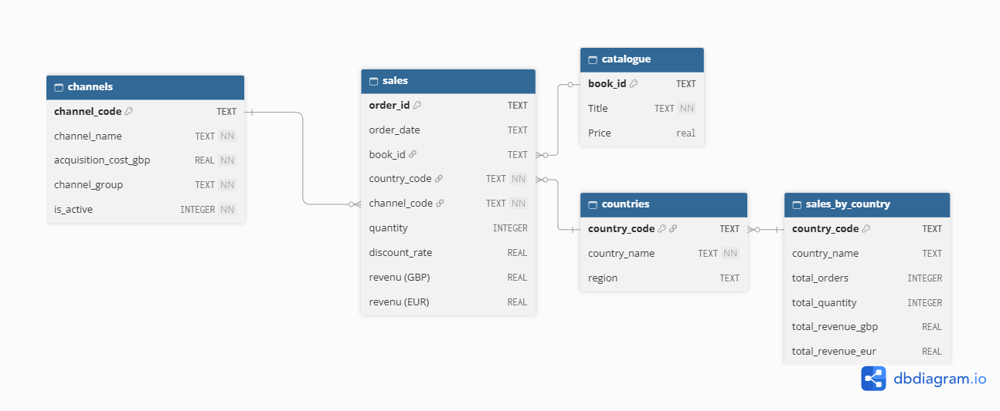

# BookWorld – Pipeline de données et API des ventes par pays

Projet réalisé dans le cadre de l'examen final RNCP Data Analyst.

Bookworld est une entreprise fictive de vente de livres en ligne. Ce projet construit un pipeline de données qui :

1. **.*collecte*.** des données depuis quatre sources : un fichier CSV de ventes, une base SQLite avec le référentiels (pays, canal et categorie), la première page du site [books.toscrape.com](https://books.toscrape.com/) (prix des livres) et l'API publique de taux de change [Frankfurter](https://frankfurter.dev/) (taux de change GBP → EUR) ;
2. **.*nettoyage - enrichissement*.** les ventes (suppression des données personnelles, prix, pays, conversion en euros) ;
3. **.*chargement*.** le résultat dans une base SQLite finale, modélisée en schéma en étoile ;
4. **.*exposition par API Rest*.** l'indicateur des ventes agrégées par pays par le biais d'une API REST protégée par token.

## Fichiers du projet

| Fichier | Rôle |
| --- | --- |
| `pipeline.py` | Pipeline ETL : extraction des 4 sources, transformation, agrégation et chargement dans la base finale |
| `api.py` | API REST Flask exposant les données de la base finale sur une adresse http |
| `schema_final.sql` | Structure de la base finale (tables, et clés primaires/étrangères), exécutée par le pipeline |
| `queries.sql` | Quelques requêtes SQL du projet : extraction/enrichissement, filtres, contrôle qualité et analyses |
| `verif_db.py` | Script de contrôle : affiche les tables et colonnes de la base finale |
| `sales_raw.csv` | Source : ventes brutes itemisées par commande |
| `bookworld_reference.db` | Source : référentiels pays,  canaux de vente et la base Catégorie qui ne sera toutefois pas utilisée - La base est en lecture seule et n'est pas modifiée par le pipeline |
| `.env.example` | Modèle du fichier de configuration du token (valeur fictive) |
| `requirements.txt` | Dépendances Python |

La base `bookworld_final.db` est **créée** par le pipeline. Elle n'est pas incluse dans le GitHub (listée `.gitignore`) - Il sera donc nécessaire d'exécuter le pipeline après avoir cloné le dépôt, pour générer `bookworld_final.db`.

## Installation

Prérequis : Python 3 et un accès Internet (le pipeline interroge le site [books.toscrape.com] et l'API [Frankfurter]de taux de change).

```bash
git clone https://github.com/DataScrap1878/RNCP_Final.git
cd RNCP_Final
python -m pip install -r requirements.txt
```

## Configuration du token API

L'API lit le token attendu dans la variable d'environnement `API_TOKEN`, chargée depuis un fichier `.env` local.

1. Copier le modèle : `cp .env.example .env` (PowerShell : `Copy-Item .env.example .env`).
2. Remplacer la valeur dans `.env` : `API_TOKEN=<votre_mot_de_passe>`.

Le fichier `.env` est exclu de Git par `.gitignore` : le vrai token n'est jamais publié. Après toute modification de `.env`, redémarrer l'API, car le fichier n'est lu qu'au démarrage.

## Exécuter le pipeline

Depuis le dossier du projet :

```bash
python pipeline.py
```

Le pipeline :

- lit les ventes (`sales_raw.csv`), les référentiels (`bookworld_reference.db`), le catalogue scrapé et le taux GBP → EUR du jour ;
- supprime les noms et prénoms des clients (RGPD) ;
- associe chaque vente à son prix (par le titre du livre) et à son pays ;
- signale les codes pays absents du référentiel et les libelle `Inconnu (code)` ;
- calcule le revenu de chaque vente : `quantité × prix × (1 − remise)`, en GBP et en EUR ;
- recrée `bookworld_final.db` à partir de `schema_final.sql` et y charge les données.

Chaque exécution remplace entièrement la base finale.

Pour vérifier le résultat :

```bash
python verif_db.py
```

## Lancer l'API

Après avoir exécuté le pipeline :

```bash
python api.py
```

L'API démarre sur `http://127.0.0.1:5000`. Elle ouvre la base finale en **lecture seule**.

### Endpoints

| Méthode | Route | Token | Description | Codes de réponse |
| --- | --- | --- | --- | --- |
| `GET` | `/health` | Non | Vérifie que la base est accessible et que la table `sales_by_country` est lisible ; renvoie son nombre de lignes | `200` OK · `503` base indisponible |
| `GET` | `/sales-by-country` | **Oui** | Renvoie les ventes agrégées par pays, triées par chiffre d'affaires décroissant | `200` OK · `401` token absent ou invalide · `500` erreur serveur |

Champs renvoyés par `/sales-by-country` : `country_code`, `country_name`, `total_orders`, `total_quantity`, `total_revenue_gbp`, `total_revenue_eur`.

### Exemples d'appels

```bash
# Contrôle de santé (sans token)
curl http://127.0.0.1:5000/health

# Sans token : refusé (401)
curl http://127.0.0.1:5000/sales-by-country

# Avec token : liste des pays (affichage formaté)
curl -s -H "Authorization: Bearer <votre_token>" http://127.0.0.1:5000/sales-by-country | python -m json.tool
```

Le token se transmet dans l'en-tête HTTP `Authorization: Bearer <token>`. Le serveur de développement Flask (HTTP, mode debug) est réservé à un usage local seulement.

## Base finale

Schéma en étoile : une table de faits (`sales`), trois dimensions (`countries`, `channels`, `catalogue`) et l'agrégat exposé par l'API (`sales_by_country`).

| Table | Contenu |
| --- | --- |
| `sales` | Une ligne par commande : date, clés vers le livre, le pays et le canal, quantité, remise, revenus GBP et EUR |
| `countries` | Référentiel des pays (code, nom, région) |
| `channels` | Référentiel des canaux de vente (code, nom, groupe, coût d'acquisition) |
| `catalogue` | Livres vendus (identifiant, titre, prix en GBP)|
| `sales_by_country` | Indicateur agrégé par pays : nombre de commandes, quantités, revenus GBP et EUR |

- **RGPD** : les noms et prénoms des clients, présents dans les données brutes, sont supprimés dès le début de la transformation et ne sont jamais stockés dans la base finale.
- **Clés étrangères** : `sales.book_id` → `catalogue` et `sales.channel_code` → `channels`. Le lien `sales.country_code` → `countries` n'est pas contraint, car le référentiel pays est incomplet (NL absent). Les ventes concernées sont conservées et libellées `Inconnu (NL)`. Une requête de contrôle dans `queries.sql` liste ces pays.



